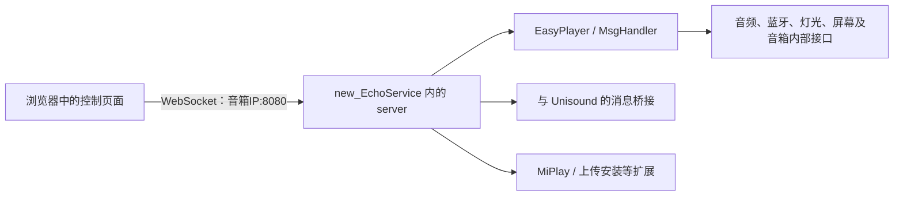

# new_EchoService 作用、签名机制与 1.8.73 → 1.8.87 对比

分析日期：2026-11-10（台北时间）。输入为用户提供的两个 APK 和更新日志 TXT。
用户补充：音箱使用原厂固件，通过普通 ADB 或网页更新安装 1.8.73。
本次不修改或安装 APK，没有连接真实音箱。

## 结论

1. new_EchoService 是对斐讯预装播放器应用的修改，保留包名和服务组件，
   增加网页需要的 HTTP/WebSocket、控制命令和扩展功能。普通网页不能直接调用音箱内部系统接口。
2. 两份样本并非“不同签名仍直接覆盖”：它们保留同一张 R1 证书，原件的 v1 验签均通过。
   两份文件同时是 DEX/APK 双格式，结构强烈符合 Janus（CVE-2017-13156）机制。
   这能解释不掌握原厂私钥也能保留原包验签结果并运行修改代码。
3. 1.8.87 的主要增量包括 MiPlay、队列编辑、独立蓝牙服务开关、底层混音器接口、
   上传安装任务管理，以及播放会话、截屏和可视化代码的调整。
4. TXT 只记录到 2022-08-10 的 1.8.72，无法提供 1.8.74–1.8.87 每版的发布时间和完整官方说明。
   下文增量来自两个实际文件的静态对比，不将网页更新日志当成 APK 更新日志。

证据摘要及工具 Evidence ID 见 [分析元数据](echo-service-apk-evidence-2026-11-10.json)。
原 APK、反编译代码和完整工具输出保留在分析环境，不提交进仓库。

## 一、为什么网页需要搭配这个服务

Android 的 Service 是应用组件；这里的 EchoService 属于斐讯音箱预装应用，
不是所有 Android 设备通用的某个同名系统核心服务。

两份 APK 的清单都声明：

| 项目 | 值 |
| --- | --- |
| 包名 | `com.phicomm.speaker.player` |
| 主服务 | `com.phicomm.speaker.player.EchoService` |
| 共享 UID 声明 | `android.uid.system` |
| 其他播放器进程 | `:AirPlayer`、`:DlnaPlayer`、`:NetPlayer` |
| 启动相关声明 | `EchoReceiver` 接收 `BOOT_COMPLETED`；应用保留 `persistent` 声明 |

这些声明本身不会无条件赋予权限；是否作为系统应用、共享系统 UID 生效，
取决于设备上的包验证和安装状态。系统 UID 通常是 1000，也不等于 root 的 UID 0。

原有播放器负责音频播放及与音箱内部服务协作。作者修改后的入口还会创建：

- `com.xiaofei.server`：其 `HttpdServer` 继承 `NanoWSD`，构造器传入 `8080`。
  Craft Anything 的原始 Dalvik 解码也直接观察到常量 `0x1f90`，即 8080。
- `EasyPlayer`、`MsgHandler`：组织播放、控制和内部消息分发。
- `sound_effects`，以及 1.8.87 新加入的 `TinyMixController`、MiPlay 与上传任务组件。

REA 分别反编译了保留下来的内层旧 APK 和外层修改代码的 `EchoService.onCreate`：
内层入口初始化播放器/消息处理；外层入口增加 `server` 并启动网络服务。
因此这不只是网页样式变化，而是在音箱上增加了一套能接收网页命令的服务端。



网页文件可以由作者网站或自己的服务器托管，设备控制连接则指向音箱。
搜索、封面、歌词及部分账号能力还可能依赖另外的网络服务。
`new_Unisound` 与 EchoService 不是同一个组件；语音唤醒、TTS、账号/音乐源等协作也不能全部归给 EchoService。

从协议角度，任何正确实现相同接口的程序都能与网页配合，并非技术上只能使用作者的实现。
但原厂 EchoService 没有这些作者新增的接口，因而不能把同一套网页直接接到未修改的原厂服务上。
1.8.73 已有网页控制、WebSocket、EQ、蓝牙控制等基础能力，并不是全部功能都要 1.8.87 才能用。

## 二、是否覆盖系统 EchoService

包名和组件名相同，正常包更新后是新版本取代旧版本运行，
而不是另外安装一个不同包名的服务，与原 EchoService 各运行一套。

结合用户确认的“原厂固件、普通 ADB 或网页更新”，应按 Android 系统应用更新流程理解：
新 APK 通常装在 `/data/app`，运行时优先使用更新包；
ROM 中 `/system/app` 或 `/system/priv-app` 下的原件通常仍保留。
这属于更新覆盖生效，不等于直接改写只读系统分区。
只有另行使用 root、刷机或手动替换文件时，才可能是直接修改系统分区。

1.8.87 的 `UploadTaskManager` 明确构造 `/system/bin/pm install -r <文件>`，
并保存安装基线摘要、任务状态和已安装文件证据，符合普通包更新这一解释。
这能说明当前上传安装器的设计，不能单凭它重建用户最初安装 1.8.73 的全部步骤。

本次没有读取用户设备上的实际路径。需要核实时，可只读执行：

```sh
adb shell pm path com.phicomm.speaker.player
```

若返回 `/data/app/...`，可确认当前生效代码来自更新包；具体系统应用标记还可在包信息中核对。

## 三、签名为什么能通过，不等于拥有原厂私钥

Android 正常情况下会拒绝同包名、不同签名的覆盖安装；涉及共享系统 UID 时也有额外匹配要求。
本次样本的实际情况是：

| 验证项目 | 1.8.73 | 1.8.87 |
| --- | --- | --- |
| 文件大小 | 7,042,950 字节 | 7,245,246 字节 |
| 文件开头 | `dex\n035\0` | `dex\n035\0` |
| 内部 ZIP 第一个本地条目偏移 | 5,881,432 | 6,083,728 |
| DEX 头声明的文件长度 | 与整个文件长度一致 | 与整个文件长度一致 |
| DEX SHA-1 / Adler-32 格式校验 | 均通过 | 均通过 |
| ZIP 中的条目内容 | 22 项 | 与另一版全部相同 |
| `apksigner verify` 的 v1 结果 | 通过 | 通过 |
| v2 / v3 签名 | 未使用 | 未使用 |
| 证书 SHA-256 | 两版相同 | 两版相同 |

证书主题包含 `CN=R1`、`OU=ShenZhen RD Center`、`EMAILADDRESS=phicomm@phicomm.com`。
证书 SHA-256 为：

```text
34a2d2fe899656af5df3fbf68e805477b3df3708ca65c842baec2de8e578bc33
```

两版不仅证书相同，内层 `AndroidManifest.xml`、`classes.dex`、
`META-INF/CERT.RSA`、`CERT.SF`、`MANIFEST.MF` 等 22 个条目内容也完全相同。
内层 DEX 的 SHA-256 都为：

```text
c6f87d0fa637ce6a090b442053797fc27b40ad1f39c9eae3f2f6fd7520447867
```

但外层 DEX 确实不同，并分别包含 `EchoService.ver = 1873` 和 `1887`。
这就是不能只解压 `classes.dex` 来比较这两份文件的原因：那样会漏掉实际修改代码。

这种布局与 Janus 的核心机制一致：旧式 APK v1 验签针对 ZIP/JAR 条目，
而存在漏洞的运行路径可能把文件开头的 DEX 当成执行代码。
保留下来的 ZIP 条目未改，原条目签名仍能通过；文件外层却承载了另一份代码。
结果是验签与代码加载对同一文件采用了不同解释。

```text
同一个文件：[修改后的 DEX 数据] + [保留条目签名的旧 APK ZIP]
                    ↑                        ↑
          符合漏洞条件时加载的代码       v1 验签查看的条目
```

Android 官方在 [2017-12 安全公告](https://source.android.com/docs/security/bulletin/2017-12-01)
列出了 CVE-2017-13156，包含 5.1.1 等受修复影响的版本。
样本表现出典型的 Janus 双格式特征；用户提供的普通更新方式也与此解释一致。
不过，本次未读取设备的安全补丁级别、ART 实际加载路径或安装日志，
不能把静态判断表述成已经在用户设备上动态复现了该漏洞。

需要区分三件事：

- APK 文件 SHA-256 改变，不代表签名证书改变。
- DEX 头里的 `signature` 是 SHA-1 摘要字段，不是原厂私钥签出的 APK 数字签名。
- 复制证书和保留未修改 ZIP 条目的原签名，不需要掌握签名私钥。

因此，样本带有同一 R1 证书，并不能推导出作者拥有原厂私钥。
本次也没有原厂 ROM 中单独导出的 APK，不能只用证书主题名称独立证明 OEM 身份；
这里可直接确认的是两份上传样本的同证书、有效 v1 验签和双格式结构。

## 四、1.8.73 → 1.8.87 已确认的主要增量

| 领域 | 1.8.73 | 1.8.87 的代码变化及意义 | 证据 |
| --- | --- | --- | --- |
| MiPlay | 完整外层类清单中没有新增这套 MiPlay 类族 | 新增接收、发现、控制、AAC/PCM 处理、分组及同步调节代码；支持本机/远端声道、队列水位和延迟参数等接口 | `EchoService.onCreate → MiPlayHost.init/connect`；`MiPlayPlayer`；`Get/Set_MiPlay_*` 分发分支 |
| 队列操作 | 没有新增的 `QueueEdit` 接口及对应处理方法 | 新增“下一首插队、移动位置、删除队列项”；网络播放器实现这些操作 | `MsgHandler` 方法号 27/28/29；`QueueEdit`；`new_NetPlayer.insertNext/moveInQueue/removeFromQueue` |
| 蓝牙服务策略 | 已有蓝牙开关、扫描、配对、A2DP 和服务常开等基础能力 | 增加持久化的独立蓝牙服务允许/禁止开关；与 DLNA/AirPlay/MiPlay 统一处理服务状态 | `Set_Bluetooth_Open`；`bluetooth_open`；`notifyServiceSettingsChanged/reconcileExternalServices` |
| 播放源切换与回调 | 原有多播放源实现 | 新增外部会话仲裁、当前会话回调检查和引擎适配层，处理接管、断开、静音以及旧会话状态 | `ExternalSessionArbiter`、`ExternalSession`、`SessionCallbackGuard`、`MusicEngineAdapter`、`DlnaExoEngine` |
| 底层混音器 | 没有 `TinyMixController` 类及新增接口族 | 增加硬件 mixer 查询、枚举、读写及 PCM 状态监听；为分路音量等新网页控件提供设备端接口 | `TinyMixController`；`setMixerValue/getMixerValue/getMixerValues/getTinyMixerAll/listAllControls` |
| 上传与安装 | 已经能上传文件、触发安装；不是全无上传功能 | 新增任务化上传、状态查询、批次 begin/seal/abort/resolve、取消/删除、历史和安装保护；安装后结合服务就绪状态处理结果 | `com.xiaofei.upload.*`；`/upload/status`、`/upload/batch/*`；`UploadTaskManager` 和 EchoService 上传健康检查线程 |
| 截屏 | 旧实现创建 `DisplayMetrics` 后反射调用截图接口 | 改为用 `WindowManager` 取得实际屏幕尺寸，检查空值及无效尺寸，再调用截图接口 | 两版 `Screencap.screenShotByReflect` 和 1.8.87 `SurfaceControl.screenshot` 路径 |
| 音频可视化/灯效实现 | 已有音频可视化及灯光功能 | 新增并接入 `VisualizerEffect` 等实现，把多个 FFT 效果分支抽到独立代码；还有新的 LED 相关类 | `PlayerVisualizer` 调用 `VisualizerEffect.effect0..effect4`；不能仅靠新类数量断言新增了多少种可见灯效 |

这里确认的是实现存在并已接入可见调用路径，不保证每种手机、网络和固件上的实际效果。
特别是音频同步、稳定性、蓝牙恢复、全部安装状态机和所有异常分支，没有真机实测。

下面这些内容不应误算：

- **不是 ExoPlayer 大版本升级。** 两个样本的 `ExoPlayerLibraryInfo.VERSION` 都为 `2.18.0`。
  播放逻辑与适配层有变化，不等于播放器库版本变了。
- **不是才增加 EQ、WebSocket、DLNA/AirPlay 或蓝牙配对。** 这些基础能力在 1.8.73 已存在。
- **不能把网页更新全部归到 APK。** 自定义 EQ 的浏览器持久化、全屏歌词、主题与界面布局等，
  主要是前端实现；多源搜索还依赖外部接口与相关服务协作。
- 网页日志标为需要 1888 的编译时间展示，不列为本次 1.8.87 已具备的增量。

## 五、版本号与日志为什么容易看错

| 项目 | 1.8.73 样本 | 1.8.87 样本 |
| --- | --- | --- |
| 代码里的业务版本 | `1873` | `1887` |
| 内层清单 versionName / versionCode | `0.2.5 / 100025` | `0.2.5 / 100025` |
| 外层 DEX 定义的类数 | 5304 | 5487 |
| ExoPlayer 版本 | 2.18.0 | 2.18.0 |

清单不变是已签名 ZIP 内容保持不变的一部分；实际功能版本以修改代码里的业务字段区分。
外层类数只作为清单规模记录，混淆名称、匿名类和编译产物会变化，不能用差值计算新增功能数量。

你提供的 TXT 最后一条是：2022-08-10，版本 1.8.72，蓝牙连接时临时禁用
AirPlay/DLNA、断开后恢复，以及修复说明。
因此它适合说明早期功能沿革，不足以列出 1.8.73 到 1.8.87 每版的更新日期。
本报告给出的是两个端点文件的增量，而非补写一份不存在的中间版本日志。

## 六、工具验证与覆盖范围

- **REA**：对原件枚举签名结构；对保留相同 ZIP 条目内容的分析视图读取清单；
  对原始 1.8.87 读取 EchoService 成员并反编译 `onCreate`；对内层旧 APK 入口作对照。
- **Craft Anything**：读取 ZIP 分析视图并验签；比较 ZIP 成员；分页完整枚举两份外层 DEX 类；
  读取服务/消息处理类，解码 HTTP 服务构造器的原始 Dalvik 指令，直接确认 8080。
- **apksigner**：对两个未修改原件执行 v1 密码学验签。REA 的签名枚举自身不等于此项验签。
- **JADX 1.5.6**：对字节与原件完全相同、仅扩展名为 `.dex` 的副本反编译。
  两版分别报告 19 / 22 处错误，不能宣称完整恢复或审阅所有函数。
- 对已核对的 `short[] XOR` 模板做静态字符串还原，没有加载或执行 APK 中的解密函数。
  未解析包装函数、分支可达性和动态行为仍作为限制保留。

工具直接把原件当作普通 APK 读取清单时会失败或认成 DEX。
因此分析分开处理外层代码和内层 ZIP；重新封装的 ZIP 视图只用于分析，不用于安装，
不能用它的 `0.2.5` 清单代替外层业务版本，也不能因为两个视图相同就认定两版程序相同。

原件 SHA-256：

```text
1.8.73  7292fcd4e2d381087fcfa19a74d83a011ab3ba6a7cdc2260301cdf66d3b6aa9f
1.8.87  54b81d9a7f9f5e11b42672aa3868eb2c40773e66961d1dc9a35dcde8993b1f20
```

结论绑定上述样本，不把同名、同版本号的其他构建视为已验证。
